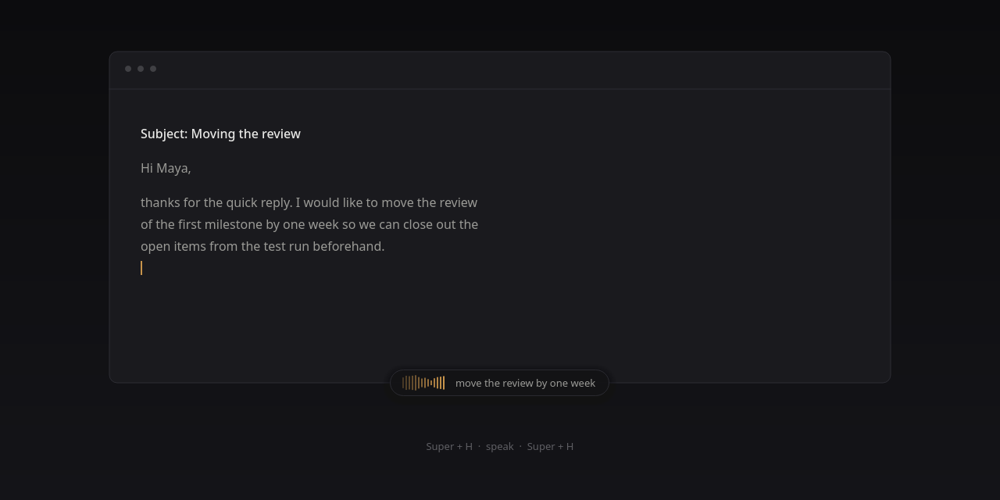
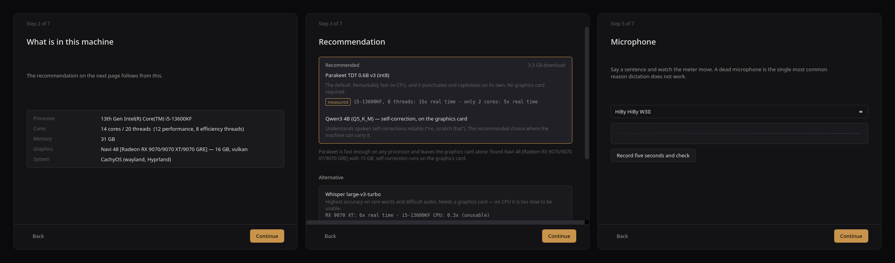
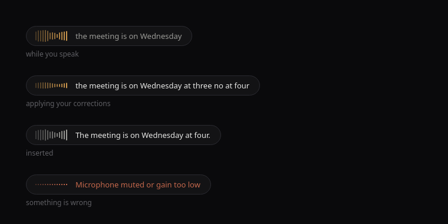

<div align="center">

# voxd

**Local dictation that understands corrections.**

Press a key, speak, and the text lands in whatever field you were typing in.
Nothing is uploaded, nothing is transcribed in a datacentre, nothing needs an account.

[](LICENSE)
[](#installation)
[](#privacy)
[](#project-status)



</div>

---

## What makes it different

Every dictation tool transcribes what you said. voxd also works out what you
**meant** — because people do not speak in finished sentences. They back up,
change their mind, and correct themselves mid-thought.

| You say | voxd writes |
|---|---|
| “…that the meeting is on **Tuesday**. **No, Wednesday.** Wednesday at three.” | The meeting is on Wednesday at three. |
| “The docs for the deployment script, **actually no, scratch that**, the docs for the CI pipeline.” | I need the docs for the CI pipeline. |
| “The server runs on port eight thousand, **hold on, no**, on port three thousand.” | The server runs on port 3000. |

Those rows are verbatim pipeline output, not illustrations.

It also understands spoken punctuation — *period, comma, question mark, new
line, new paragraph, quote, capitalise* — and strips the *um*s and *uh*s.

### How it works

Two stages. The recogniser transcribes literally, including “no, Wednesday”.
A small local language model then reads that transcript and works out that the
correction was an **instruction to itself**, not part of the text.

```
  microphone ──▶ voice activity detection ──▶ speech recognition
                                                      │
                                             raw transcript
                                                      │
                                              editing pass  ◀── local LLM
                                                      │
                                              final text ──▶ your text field
```

A length guard sits at the end: if the edited text is more than 2.5x or less
than 0.3x the length of what you actually said, voxd inserts the raw transcript
instead and flags it. The language model can never quietly put words in your mouth.

---

## Runs on almost anything

The default recogniser is **Parakeet TDT 0.6B v3**, fast enough on a plain CPU
that a graphics card becomes optional rather than required.

| Machine | Speed | Source |
|---|---|---|
| i5-13600KF, 8 threads | **15x real time** | measured |
| i5-13600KF, **2 cores only** | **5x real time** | measured |
| Whisper large-v3-turbo, same CPU | 0.3x real time — unusable | measured |

That last row is why Parakeet is the default. Whisper is excellent, but it needs
a GPU; Parakeet does not, and on real speech it produced **better sentence
segmentation and capitalisation** in side-by-side testing.

Whisper large-v3-turbo stays available for anyone who wants it and has the
hardware to run it.

---

## Setup

First launch opens a seven-step wizard. No terminal, no config files, no model
paths to look up.



It reads the actual machine — cores, memory, GPU vendor and VRAM, session type —
and derives **exactly one** recommendation from it, stated in a sentence. Speed
figures carry a `measured` tag where they were timed on real hardware; estimates
do not get one.

| What is detected | Recogniser | Editing pass |
|---|---|---|
| Anything, including old laptops | Parakeet v3 int8 (~640 MB) | none — Parakeet punctuates on its own |
| ≥ 8 GB RAM, 4+ threads | Parakeet v3 | Qwen3 1.7B on CPU |
| ≥ 12 GB RAM, 8+ threads | Parakeet v3 | Qwen3 4B on CPU |
| GPU with ≥ 5 GB VRAM | Parakeet v3 | Qwen3 4B on the GPU |

Step five is the one that matters most: a live level meter and a five-second
test recording, so you find out the microphone works **before** setup finishes
rather than the first time dictation silently fails.

---

## The overlay

While you speak, a single flat capsule sits at the bottom of the screen. No
status words, no progress bar, no icons — the level meter shows it is listening,
and the brightness of the text shows whether it is still provisional.



It never takes keyboard focus, which is what keeps the text going into your
field rather than into the overlay.

---

## Installation

> **Status:** in development. Linux is tested; Windows is written but not yet
> verified on real hardware. See [Project status](#project-status).

### Linux

```bash
git clone https://github.com/Noxy229/voxd
cd voxd
./install.sh
```

The installer creates its own Python environment, so the distribution barely
matters. It detects `pacman`, `apt`, `dnf`, `zypper` or `apk` for the handful of
system packages needed to type into other windows, and shows you the exact
command rather than running things behind your back.

### Windows

Download the installer from [Releases](https://github.com/Noxy229/voxd/releases).
No administrator rights required.

---

## Keyboard shortcut

| Shortcut | Action |
|---|---|
| `Super + H` | Start dictation; press again to finish and insert |
| `Super + Shift + H` | Same, but raw — skips the editing pass |
| `Super + Alt + H` | Discard the current dictation |

On Wayland no application can grab global hotkeys — the protocol forbids it, and
anything claiming otherwise needs root. voxd therefore registers the binding
**with your compositor** (Hyprland, Sway, niri, river) or through your desktop's
own shortcut settings. On Windows it uses `RegisterHotKey`.

---

## Typing into other applications

Wayland has no single reliable way to type into another window, so voxd uses a
chain and remembers which rung worked for each application:

1. **`wtype`** — the Wayland virtual-keyboard protocol. Handles Unicode
   correctly, including accents, umlauts and em dashes. The normal case.
2. **`ydotool`** — goes through the kernel's uinput layer, so it reaches
   XWayland windows and applications that ignore the virtual-keyboard route.
   ASCII only.
3. **Clipboard + paste** — the last resort that works everywhere, including
   Electron apps. The previous clipboard contents are saved and restored, and
   the entry is removed from clipboard history afterwards.

On X11 the chain starts with `xdotool`; on Windows with `SendInput`.

---

## Privacy

There is no network code in the dictation path. Audio is captured, processed in
memory, and discarded. Models are downloaded once, during setup, from Hugging
Face — after that voxd never needs a connection again.

---

## Project status

| Area | State |
|---|---|
| Hardware detection, model catalogue, recommendation | working; tested across four hardware profiles |
| Audio capture, level metering, microphone test | working on Linux |
| Overlay, setup wizard, design system | working |
| Speech recognition (Parakeet, Whisper) | benchmarked; integration in progress |
| Editing pass (self-correction) | working |
| Text injection chain | working on Wayland |
| Windows support | written, **not yet tested on real hardware** |
| Packaging and installers | in progress |

Anything marked untested is labelled that way deliberately, and stays labelled
until someone has actually run it.

---

## Built on

[sherpa-onnx](https://github.com/k2-fsa/sherpa-onnx) (Apache-2.0) ·
[Parakeet TDT v3](https://huggingface.co/nvidia/parakeet-tdt-0.6b-v3) (CC-BY-4.0) ·
[whisper.cpp](https://github.com/ggml-org/whisper.cpp) (MIT) ·
[llama.cpp](https://github.com/ggml-org/llama.cpp) (MIT) ·
[Qwen3](https://huggingface.co/Qwen) (Apache-2.0) ·
[Silero VAD](https://github.com/snakers4/silero-vad) (MIT) ·
[Qt / PySide6](https://www.qt.io/qt-for-python) (LGPL-3.0)

Prior art worth reading: [Handy](https://github.com/cjpais/Handy) solves the same
problem without the self-correction stage, and is worth your time if that is all
you need.

## License

MIT — see [LICENSE](LICENSE).
